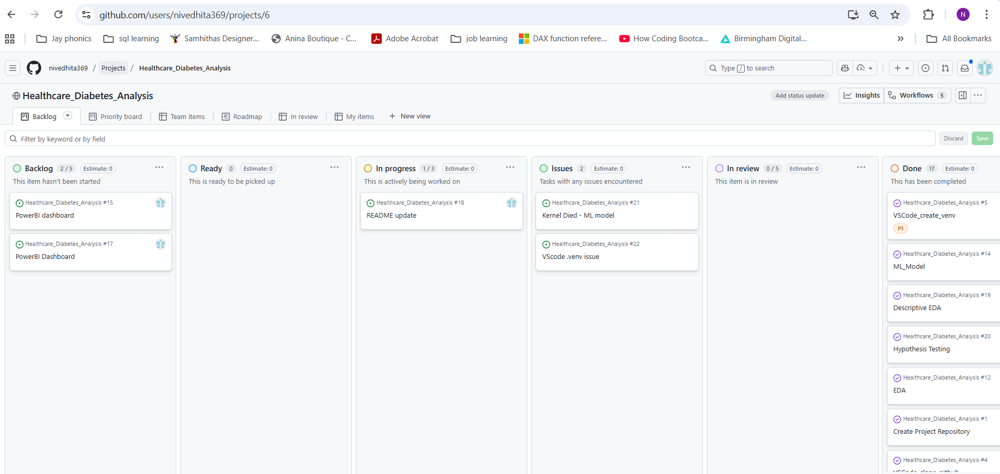
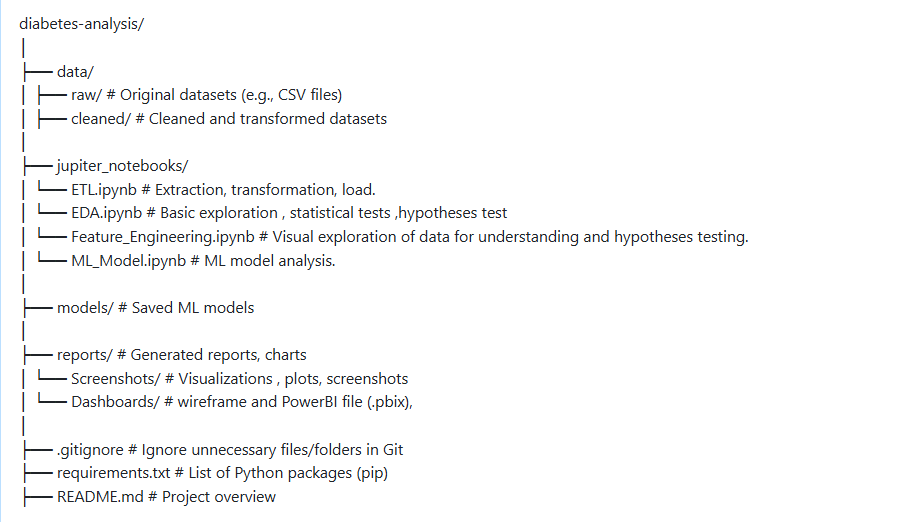

# Project Diabetes Analysis 

This project explores healthcare data to understand the key factors associated with diabetes by analyzing patterns and relationships in patient features. Using Machine learning model as a tool to interpret and explain the factors influencing diabetes classification.

# 

## Dataset Content
* Input is the diabetes_prediction_dataset.csv file downloaded from Kaggle: https://www.kaggle.com/datasets/iammustafatz/diabetes-prediction-dataset.
* The dataset contains contains medical and demographic data of patients along with their diabetes status.
* The 8 features in the dataset include:
  - age                     : Patient's age in years.
  - gender                  : Biological sex of the patient (e.g., Male, Female, Other)
  - body mass index (BMI)   : A measure of body fat based on height and weight (kg/m²).
  - hypertension            : Presence of high blood pressure (1 = Yes, 0 = No).
  - heart disease           : Presence of heart condition (1 = Yes, 0 = No).
  - smoking history         : Patient’s past or current smoking behavior (e.g., never, former, current)
  - HbA1c level             : Average blood sugar level over the past 2-3 months (%).
  - blood glucose level     : Current blood sugar level (usually measured in mg/dL).

* The target variable is:
  - diabetes                : Indicates whether the patient has diabetes (1 = Yes, 0 = No).

* The original dataset is quite huge with 100K records. 
* The target variable is imbalanced with only ~9% positive for diabetes. This could be a representation of real-world prevalence.
* For the purpose of this project, a subset of 10K records is extracted by randomly sampling 5k records from each target class to preserve balance for model training and evaluation.

## Business Requirements

* The primary business requirement is to gain a deeper understanding of the key health indicators and risk factors associated with diabetes within the patient population. 
* The insights derived from this analysis will help healthcare professionals, policy makers, and stakeholders make informed decisions regarding early intervention, resource allocation, and patient education. 
* Additionally, by applying interpretable machine learning models, we aim to identify which features (e.g., age, BMI, blood glucose levels) most influence diabetes classification there by alerting patients at risk and enabling proactive healthcare measures.
* The project also aims to create an interactive dashboard that effectively communicates these insights to both technical and non-technical audiences, facilitating data-driven decision-making in healthcare settings.

## Hypothesis and how to validate?
* Below are the hypotheses I came up with based on the dataset and business requirements.

### 1) Association between HbA1c and Blood Glucose Levels with Diabetes

- **Null Hypothesis (H₀):**  
  There **no association** between HbA1c levels and diabetes status; and no association between blood glucose levels and diabetes status.

- **Alternative Hypothesis (H₁):**  
  Higher HbA1c levels and blood glucose levels are **significantly associated** with an increased likelihood of diabetes.

  - **Validation Technique:**
  * Since these are numeric variables(not normalised), I used Mann-whitney U test to compare the distributions of HbA1c and blood glucose levels between diabetic and non-diabetic groups.

  - **Conclusion:** 
  * The P-value was < 0.05 leading to rejection of null hypothesis and acceptance of alternative hypothesis.

### 2) Impact of Hypertension and Heart Disease on Diabetes

- **Null Hypothesis (H₀):**  
  There is **no association** between hypertension and diabetes status; and no association between heart disease and diabetes status.

- **Alternative Hypothesis (H₁):**  
  Individuals with hypertension and heart disease are **more likely** to have diabetes.

- **Validation Technique:**
  * Since these are numeric binary variables, I used Chi-square test of independence. 

- **Conclusion:**
  * The P-value was < 0.05 leading to rejection of null hypothesis and acceptance of alternative hypothesis.

### 3) Association between BMI and Diabetes

- **Null Hypothesis (H₀):**  
  BMI is **not associated** with diabetes status.

- **Alternative Hypothesis (H₁):**  
  Higher BMI is **associated** with increased diabetes prevalence.

- **Validation Technique:**
  * Since this is a numeric variable(not normalised), I used Mann-whitney U test to compare the distributions of BMI between diabetic and non-diabetic groups.

- **Conclusion:** 
  * The P-value was < 0.05 leading to rejection of null hypothesis and acceptance of alternative hypothesis.

### 4) Association between Smoking and Diabetes

- **Null Hypothesis (H₀):**  
  Smoking status is **not associated** with diabetes status.

- **Alternative Hypothesis (H₁):**  
  Smokers have a **significantly higher chance** of having diabetes compared to non-smokers.

- **Validation Technique:**
  * Since this is a categorical variables, I used Chi-square test of independence. 

- **Conclusion:**
  * The P-value was < 0.05 leading to rejection of null hypothesis and acceptance of alternative hypothesis.

### 5) Association between Age and Diabetes

- **Null Hypothesis (H₀):**  
  Age is **not associated** with diabetes status.

- **Alternative Hypothesis (H₁):**  
  Older individuals have a **significantly higher prevalence** of diabetes.

- **Validation Technique:**
  * Since this is a numeric binary variable(not normalised), I used Mann-whitney U test to compare the distributions of age between diabetic and non-diabetic groups.

- **Conclusion:** 
  * The P-value was < 0.05 leading to rejection of null hypothesis and acceptance of alternative hypothesis.

### Impact of Key Factors on Diabetes

* Based on the EDA and hypothesis testing, the individual impact of key factors on diabetes is summarised below:

- **HbA1c, Blood Glucose & BMI:** Higher levels are strongly associated with increased diabetes risk.  
- **Age:** Older age shows a significant association with higher diabetes likelihood.  
- **Hypertension:** Exhibits a moderate association with diabetes.  
- **Heart Disease:** Shows a weak to moderate association with diabetes.  
- **Gender:** Has minimal association with diabetes.  
- **Smoking History:** Displays weak to moderate association; a large 'Unknown' category (22.4%) is retained to avoid data loss or bias.

* For categorical variables, Chi-square tests were conducted, using **Cramér’s V** to assess the strength of associations. 

* For numeric variables, the **Mann-Whitney test** was applied, with mean and median values compared across diabetes and non-diabetes groups to interpret the differences.

## Project Plan

### 1. High-Level Steps of the Analysis
* The project was structured into several key phases to ensure a systematic and reproducible data analysis process:

### 1.1 Problem Definition
* Here I defined the business requirements and objectives of the analysis. This involved understanding the context of diabetes, its risk factors, and the goals of the analysis.

### 1.2 Data Collection
- **Source**: * Dataset is downloaded from Kaggle: https://www.kaggle.com/datasets/iammustafatz/diabetes-prediction-dataset
* The dataset contains contains medical and demographic data of patients along with their diabetes status.
* The original dataset is quite huge with 100k records. 
* The target variable is imbalanced with only ~9% positive for diabetes. This could be a representation of real-world prevalence.
* For the purpose of this project, a subset of 10k records is extracted by randomly sampling 5k records from each target class to preserve balance for model training and evaluation.
* This sampled dataset is used as input for all subsequent analysis.
* All steps of the analysis are documented in a Jupyter Notebook (ETL.ipynb - extraction phase).

### 1.3 Data Preprocessing & Cleaning
* Here I performed data cleaning tasks such as handling missing values, correcting data types, and removing duplicates and any unwanted data.
* Noticed that the age column had infants,toddlers and children as well. But the dataset also had smoking history and bmi columns which as lifestyle factors are not relevant for children. Hence I removed all records with age < 18 years.
* There were around 21 duplicate records which were removed upon careful consideration.
* Gender had a value "Other" in 1 record which was removed as it was not possible to draw any inference from a single record.
* Smoking history had value of "No Info" which were kept as a separate category for futher exploration in EDA phase.
* All steps of the analysis are documented in a Jupyter Notebook (ETL.ipynb - transformation phase).

### 1.4 Exploratory Data Analysis (EDA)
* EDA was performed in 2 phases:
  * **Descriptive EDA** - Here I explored the data using summary statistics and visualisations to understand distributions, relationships, and patterns in the data. This helped in identifying potential features for further analysis.
  * **Hypothesis Driven EDA** - Here I formulated specific hypotheses based on the business requirements and tested them using appropriate statistical methods. This phase helped in validating or refuting assumptions about the data.
* All steps of the analysis are documented in a Jupyter Notebook - EDA.ipynb

### 1.5 Feature_Engineering
* Here I created new features or transformed existing ones to enhance the predictive power of the dataset, preparing it for machine learning modeling and for dashboard visualisations.
* For dashboarding:
  * Created age groups from age column for better visualisation.
  * Created BMI categories from BMI column for better visualisation.
  * Created a  new feature "diabetes_risk" based on HbA1c and blood glucose levels to categorise patients into low, moderate, high and very hish risk for diabetes.
  * Reduced the smoking into 3 categories for bertter visualisation.
* For Machine Learning : 
  * I one-hot encoded categorical variables gender and the new smoking category variable, so the classification algorithm can have a numeric representation of these variables.
  * Used Winzorization to handle outliers in HbA1c and bmi.
* All steps of the analysis are documented in a Jupyter Notebook - Feature_Engineering.ipynb

### 1.6 Modeling & Evaluation
* Did standard scaling, feature selection and model using pipelines.
* Performed model training and evaluation using various 2 classification algorithms - Logistic Regression and Random Forest.
* used confusion matrix, classification report to evaluate model performance.
* Accuracy, Precision, Recall were the key metrics used to compare model performance.
* Random Forest was the best performing model with test accuracy of 90% and recall of 94%.
* Used prediction probabilities from the best model on the test set to predict diabetes risk.
* Plotted the feature importance from the best model to understand the key factors influencing diabetes classification and their relative importance.
* After I got the best estimator, I ran into Vscode issue. Hence commented out the code gridsearch and used the best estimator parameters directly to build the final model.( the code is present in the notebook but commented out).
* All steps of the analysis are documented in a Jupyter Notebook - ML_Model.ipynb

### 1.7 Interpretation of Results
- Analyzed feature importance to understand predictors of diabetes.
* Interpreted model coefficients to explain relationships between features and diabetes risk.
* Summarized key findings from EDA and modeling phases. 
* All the results are documented across EDA and ML_Model notebooks soon after their respective analysis.

### 1.8 Output files
* Loaded all the output files from each phase of the analysis into the data folder across 3 subfolders - raw, cleaned and transformed.
* **Raw folder** -  contains the original dataset and the sampled dataset used for analysis.
* **Cleaned folder** - contains the cleaned dataset after ETL phase.
* **Transformed folder** contains the 3 final datasets after feature engineering phase and ML model     
    - 2 files from feature engineering phase - one for dashboarding and one for ML modeling.
    - 1 file from ML modeling phase - contains the test set with risk score from the best model.

### 1.9 Dashboard
* Develop an interactive Power BI dashboard to analyze key factors influencing diabetes using demographic and health data. Integrate clear insights and annotations to make findings accessible to both technical and non-technical users. Compare machine learning model performances to guide decision-making. Ensure seamless interactivity across visuals for dynamic, user-driven exploration.

## 2 Project Planning Tools
* Used Kanban board in GitHub Projects to plan and track the progress of the project.
* Created columns for Backlog, Ready,In Progress, Issues, Review, and Done to manage tasks effectively.
* Created milestones for each major phase of the project:
  * Milestone 1: Project Setup + Basic ETL
  * Milestone 2: ETL finalisation + Exploratory Data Analysis (EDA)
  * Milestone 3: EDA conclusion + Feature Engineering
  * Milestone 4: ML Modeling + PBI Dashboard
  * Milestone 5: Final Review and Submission
* ALso created issues for each task, assigned them to respective milestones, and tracked their progress using the Kanban board.

## Vscode Project Structure
* The project is structured into several key directories and files to ensure organization and clarity:
  * **data/**: Contains the dataset files used in the analysis, organized into subfolders for raw, cleaned, and transformed data.
  * **jupyter_notebooks/**: Contains Jupyter Notebooks for each phase of the analysis, including ETL, EDA, Feature Engineering, and ML Modeling.
  * **reports/**:
      * Contains the wireframe and the PowerBI dashboard file in the Dasbbaord folder.
      * Contains images used in the README file in the Images folder.
  * **README.md**: Provides an overview of the project, including objectives, methodology, and instructions for replication.
  * **.gitignore**: Specifies files and directories to be ignored by Git version control.
      * Original dataset with 100k records is ignored to avoid large file size in the repo.
  * **requirements.txt**: Lists the Python libraries and dependencies required to run the analysis.
  * **.venv**: Contains virtual environment variables (if any) needed for the project.
  * Below is the kanban board screenshot from GitHub Projects showing the project planning and task tracking.
  
  * Below is the screenshot of the project structure I initially planned. There were some changes made during the project development which are reflected in the actual project structure.
  
  

## The rationale to map the business requirements to the Data Visualisations

### 1. Gain a deeper understanding of the key health indicators and risk factors associated with diabetes within the patient population. 

* Used the below visualisations to explore the distributions and relationships of key features with diabetes status.
  * Univariate - To understand distributions of individual features.
      * Continuous Numeric features : Histogram + KDE plot.
      * Binary Numeric  features : Bar plot with % value annotations.
      * Categoical features : Count plot to check the frequency of each category.
  * Bivariate - To understand relationships between individual features and diabetes status.
      * Continuous Numeric features vs Diabetes : Box plot to compare distributions across diabetes status.
      * Binary Numeric features vs Diabetes : Bar plot with % value annotations to compare proportions across diabetes status.
      * Categorical features vs Diabetes : Bar plot with % value annotations to compare proportions across diabetes status.
  * Multivariate: To understand relationships between multiple features and diabetes status.
      * Scatter plot to visualize relationships between 2 continuous numeric features coloured by diabetes status. Interactive plot to enable zooming and hovering for details.
      * Correlation heatmap to identify correlations between continuous numeric features.

### 2. Identify which features most influence diabetes classification.
* Performed Logistic regressiona and Random Forest classifier ML models and used feature importance plot from the best model to identify and rank the key features influencing diabetes classification.

### 3. Create an interactive dashboard that effectively communicates these insights to both technical and non-technical audiences.
* The multivariate scatter plot is an interactive plot to enable zooming and hovering for details.
* The PowerBI dashboard has interactive filters to enable users to explore data insights based on their interests.

### 4. Enable data-driven decision-making in healthcare settings.
* The dashboard is designed to communicate complex data insights to different audiences using a combination of visualisations, text explanations, and interactive elements.
* Summarised key findings from EDA and modeling phases in the dashboard. (Mean, median values etc as KPI cards) 

## Analysis techniques used

### 1. Data Cleaning:

* Used Pandas library in Python for data manipulation and cleaning tasks.
* Used functions like .shape(), .info(), .describe(), .isnull(), .duplicated().sum(),  to understand data structure and identify missing values, duplicates.
* Handled duplicates using .drop_duplicates() function.
* Used filtering and conditional selection to remove irrelevant records (e.g., age < 18 years).
* Handled categorical variables using .nunique(), .value_counts() to understand  cardinality and their distributions.

### 2. Exploratory Data Analysis (EDA):
* Used Pandas, Matplotlib, Seaborn, plotly, pingouin, scipy.stats libraries in Python for EDA.
* Used summary statistics (mean, median, mode, standard deviation, percentiles) to understand distributions and central tendencies of numeric features.
* Used visualisations like histograms, box plots, bar plots, count plots, scatter plots.
* Used correlation heatmap to identify correlations between continuous numeric features.
* Used normality tests like Shapiro-Wilk test to check normality of numeric features.
* Used statistical tests like Mann-whitney U test and Chi-square test of independence to validate hypotheses.

### 3. Feature Engineering:
* Used pandas and numpy libraries in Python for feature engineering tasks.
* Used  feature engine one-hot encoding and winsorization libraries for encoding categorical variables and handling outliers respectively.
* Used scikits learn library pipelines to streamline the feature engineering process.
* Created new features using conditional selection and binning techniques.
* Transformed existing features using encoding and outlier handling techniques.

### 4. Machine Learning Modeling:
* Used pandas, scikits-learn libraries in Python for ML modeling tasks.
* Used train_test_split function to split data into training and testing sets.
* Used supervised learning algorithms - Logistic Regression and Random Forest classifier.
* Used GridSearchCV for hyperparameter tuning.
* Used confusion matrix, classification report to evaluate model performance.
* Used accuracy, precision, recall as key metrics to compare model performance.
* Used feature importance plot from the best model to identify key factors influencing diabetes classification.
* Used prediction probabilities from the best model on the test set to predict diabetes risk.
 
### 5. Dashboarding:
* Used PowerBI to create an interactive dashboard to communicate insights to both technical and non-technical audiences.
 **Comprehensive Exploration:** Analyze key demographic, health, and risk factors influencing diabetes using interactive visualizations and clear summary metrics.  
- **Insightful Communication:** Include annotated notes and tooltips to make insights easy to understand for both technical and non-technical users.  
- **Model Performance Evaluation:** Compare Logistic Regression and Random Forest models focusing on accuracy, recall, and false negatives to inform model choice.  
- **Interactive User Experience:** Provide dynamic cross-filtering across visuals, enabling users to explore relationships and outcomes based on their interests.

### 6. Limitations and alternative approaches:
* The original dataset is very huge with 100k records. The target variable is imbalanced with only ~9% positive for diabetes. This could be a representation of real-world prevalence.
* So for the purpose of this project, a subset of 10k records is extracted by randomly sampling 5k records from each target class to preserve balance for model training and evaluation.
* This sampling approach may limit the generalizability of the findings to the broader population. But for the purpose of this project, this approach was taken to ensure balanced classes for model training and evaluation.
* The dataset lacks certain potentially relevant features such as physical activity levels, dietary habits, and family history of diabetes. The absence of these variables may limit the comprehensiveness of the analysis and the ability to capture all factors influencing diabetes risk.
* Alternative approaches could include using techniques like SMOTE for handling class imbalance instead of random sampling. Additionally, exploring other machine learning algorithms such as Gradient Boosting or Support Vector Machines could provide further insights into diabetes classification.
* I plan on exploring these alternative approaches in future iterations of the project upon acquiring more knowledge and skills.
* Learn about the ROC-AUC metric and use it for model evaluation in future.

### 7. Generative AI tools used:
* Used gen-AI to help  with:
  * Brainstorming ideas and identifying potential approaches.
  * Troubleshooting code errors and bugs.
  * Code optimisation and good practices.
  * For summarising the key findings from EDA and ML modeling phases.
  * For markdown formatting and various sections in the README.md file.
  * For comminicating insights in the PowerBI dashboard.
  * Vscode copilot helped with autosuggestions while writing the README.md file.
  * Used chatGPT for code snippets for adding % value annotations on bar plots.
  * Used chatGPT to understand the concept of zipping to iterate through multiple lists in parallel.

 ## Ethical considerations

### 1. **Data Privacy**
- The dataset used in this project was sourced from **Kaggle**, and is publicly available.
- It does **not contain any personally identifiable information (PII)** such as names, addresses, or contact details.
- As a result, there are **no direct privacy concerns**, and the dataset is considered safe for public use and educational purposes.

### 2. **Bias and Fairness**
- The original dataset was **heavily imbalanced**, with only ~9% positive diabetes cases. This reflects real-world prevalence but could bias models toward predicting the majority class.
- To address this, a **balanced subset** was created for training purposes. However, this may limit generalizability to real-world populations.
- Also, there are thechniques like SMOTE could be explored in future iterations to handle class imbalance.
- No demographic features such as race, income, or region were included, so potential **socioeconomic or racial biases could not be assessed** or mitigated.
- Future versions of this project should consider **fairness-aware modeling** if such demographic variables are available.

### 3. **Legal and Societal Considerations**
- The dataset is shared pulic and is intended for educational and research purposes.
- There are **no legal restrictions** on its use, and it complies with standard data ethics as it does not involve human subject experimentation.
-It does not include personally identifiable information (PII), and therefore complies with common data protection laws such as the General Data Protection Regulation (GDPR) in the EU and similar frameworks globally.
- However, caution should be taken when **applying the results to real-world decision-making**, as there are many factors influencing diabetes risk that are not captured in this dataset.
- In summary, while the current dataset is legally and ethically safe for educational use, applying such models in practice requires careful governance, transparency, and fairness, with attention to both legal obligations and societal impacts.

### 4. **Responsible Use**
- The results of this project are meant to be **illustrative and exploratory only for educational purpose**, not diagnostic.

## Dashboard Design

#### 📊 Power BI Dashboard: Diabetes Prediction and Risk Analysis

This dashboard explores key factors contributing to diabetes using data visualizations and machine learning model evaluation. Built in Power BI and supported by data preprocessing and model training in Python (using Scikit-learn), this dashboard aims to deliver clear, interactive insights for both technical and non-technical audiences.

#### 🗂️ Dashboard Sections

### 1️⃣ Overview

**Audience:** Non-technical and business users  
**Purpose:** High-level summary of the dataset and diabetes-related trends.

- Displays key health metrics: BMI, glucose, HbA1c  
- Interactive slicers allow filtering by demographic and health attributes  
- Summary insights highlight key patterns and correlations  
- Simple, clean visuals for quick understanding.
- Slicers for interactive filtering.

### 2️⃣ Demographics & Health Metrics

**Audience:** Technical Analysts, non-technical healthcare professionals  
**Purpose:** Visualize how diabetes relates to age, glucose, HbA1c, and other health indicators.

- **Scatter Plot:** Compares glucose vs. HbA1c across diabetes status  
- **Stacked Column Chart:** Shows diabetes risk by age group and category  
- **Yellow Line:** Tracks % of diabetes cases by age  
- Hover tooltips reveal extra context (BMI, diabetes status,age_group etc.)  
- Fully interactive — selections in one plot update the others

### 3️⃣ Key Influencers & Health Metrics

**Audience:** Both technical and non-technical users seeking detailed analysis.
**Purpose:** Highlight features most influential in predicting diabetes.

- **Key Influencers Visual:** Ranks variables by their impact  
- **Multi-card Visual:** Shows average BMI, HbA1c, median glucose, and diabetes % per age group  
- Clicking a row updates the related visual for detailed comparison  

### 4️⃣ Model Metrics

**Audience:** Primarily for technical users. For informed non-technical users interested in model performance.
**Purpose:** Compare performance of machine learning models used for diabetes prediction.

- Evaluates **Logistic Regression** vs **Random Forest**  
- Key metrics shown:
  - **Accuracy** (Train/Test)
  - **Recall** (focus on diabetes class)
  - **False Negatives** (missed diagnoses)
- Verdict: **Random Forest** performs better across all metrics, especially in recall — critical for healthcare prediction.

### 🗣️ Insights Communication

To make the dashboard easy to understand and accessible to both technical and non-technical users, each report section includes:

- **Text annotations and notes** that explain:  
  - The relevance of the plot to diabetes analysis  
  - Key takeaways and trends to observe

- Use of **simple, clear language** to highlight insights without requiring a technical background.
- **Interactive visuals** enhanced with hover tooltips providing additional context.  

This approach ensures:  
- **Non-technical users** can confidently interpret the findings.  
- **Technical users** can quickly grasp the data story and visual logic.  
- The dashboard functions both as an **analytical tool** and a **communication platform**

### 🧠 Interactivity Note

All Power BI visuals are interactive:  
Selecting a data point or model updates related charts and tables dynamically.
This interactivity allows users to explore relationships and drill down into specific segments of interest, enhancing understanding and engagement with the data.

## Unfixed Bugs
* There are no unfixed bugs in the project. All code has been tested and verified to work as intended.
* I did have to refer back to the course material and online resources for coding help.
* With the ML phase, though I know the flow/logic, I am not very comfortable with the coding part yet. So I did refer back to the course material.
* I plan to improve my coding skills in this area in future.
* Learn best practices for coding, code documentation and commenting.
* Improving my skills in powerBI as well.

## Development Roadmap

### Challenges Faced
* On day 4 of project development, I faced issues with Kernel crashing. Contacted my facilitator Vasi and coach Niel for help. Initially we thought it was due to high memory usage for ML model training. 
* As per the suggestion from my coach tried deleting the .venv and recreating it, the issue persisted. Recreated the entire project from github repo in a new location and the issue still persisted. Finally came to know it was due to some issue with vscode recent update.
* So I was suggested to use codespace on github to run the jupyter notebooks. Since it was new, it did take some time to get used to it. But I was able to work on the notebooks without any issues. Thanks to Vasi who helped me with answeiring my queries on codespace.
* Luckily the issue with vscode got resolved by EOD and I was able to continue my work on vscode. Though it was a bit troublesome, I was able to learn a new tool - codespace on github.

### Learnings
* This project was a great learning experience for me. I was able to apply the concepts learned during the course in a real-world scenario.
* I was also able to the learn the below:
  * Intially thought of performing t-test. But after checking for normality, I found that the numeric variables were not normally distributed. So I went back to the LMS and looked for which non-parametric test to use and found Mann-whitney U test. This helped me understand the importance of checking for normality before choosing a statistical test.
  * While performing Mann-Whitney U test for the numeric variables, I started with one variable at a time. After the 2nd varible realised the redundancy of code and did a loop through the numeric variables and perform the test in one go. But the results wern't in a convenient way to interpret. So I looked up online and found a way to store the results in a dataframe which was easy to interpret. This helped me understand the importance of code optimisation and reusability.

### Skills to hone
* I would like to improve my skills in Machine Learning algorithms and techniques.
* For example, I could keep the bias in the original dataset and use techniques like SMOTE to handle class imbalance instead of random sampling.
* Secondly, I performed logistic regression and random forest classifier algorithms for ML modeling seperately. I know that multiple models can be passed in a pipeline and the best model can be selected based on a metric. Though I did learn it during the course, I wasn't comfortable implementing it during the project yet. I would like to improve my skills in this area.
* I did create some new features in feature engineering phase for better visualisation in the dashboard. I knew I could do this in PowerBI itself. But for this project, I prefered to do in Python. I would like to improve my skills in PowerBI as well.
* I did the wireframe in powerBI itself with empty sketches and text descriptions of the visualisations. I would like to improve my skills in tools like Balsamiq to create better wireframes.

## Main Data Analysis Libraries
* Below are the main libraries used for data analysis in this project:
**Pyhton Libraries:**
  * Pandas - for data manipulation and analysis.
  * Numpy  - for numerical computations.  
  * Matplotlib   - for data visualisation.
  * Seaborn -   for statistical data visualisation.
  * Plotly -  for interactive data visualisation.
  * Scipy.stats - for statistical tests and analysis.
  * Pingouin -  for normality tests and statistical analysis.
  * Scikits-learn - for pipeline, scaling, feature selection, model training, machine learning algorithms and model evaluation.
  * Feature-engine - for feature engineering tasks like one-hot encoding and winsorization.
**PowerBI** - for creating interactive dashboards to communicate insights.

## Application of data analytics in healthcare

This project explores how data analytics can be applied within the healthcare domain, specifically focusing on diabetes risk prediction. In recent years, healthcare systems worldwide have increasingly adopted data-driven methods to improve patient care, reduce operational costs, and support preventive medicine.

By leveraging historical health data, analytics can help in:

- **Early detection** of diseases such as diabetes.
- Identifying **high-risk groups** based on medical and lifestyle indicators.
- Supporting **personalized treatment plans** through predictive modeling.
- Informing **public health policies** with evidence-based insights.

In this project, predictive models and visual analytics were used to uncover patterns in patient attributes that correlate with diabetes risk. While this is a simplified case for educational purposes, similar techniques are widely used in real clinical settings to improve decision-making and patient outcomes.

## 🗺️ Project Plan & Future Development

Although this capstone project is based on a static dataset, a long-term plan would be essential if this were to evolve into a production-level solution. Below are key areas identified for future exploration and enhancement:

### 🔄 1. Data Collection and Enrichment

The current dataset does not include several important factors that can significantly influence diabetes risk, such as:

- **Family medical history**
- **Geographic location**
- **Physical activity levels**
- **Dietary patterns**

If a dataset becomes available that includes these features, I plan to explore methods for **merging it with the current dataset** to build a more robust and comprehensive model.

Additionally, I would investigate:
- How additional features affect model accuracy and interpretability

### 🧠 2. Model Improvement

Based on my learnings during this project, I would like to:

- Experiment with alternative logistic models such as **Decision Trees, XGBoost**.
- Explore the use of **model interpretability tools** like SHAP or LIME to better understand feature impact.
- Implement **cross-validation** to ensure model robustness.
- Compare model performance with and without the additional features from the extended dataset

### 📈 3. Ongoing Evaluation and Maintenance (Hypothetical)

If deployed, the model should be:
- Retrained periodically as new data becomes available
- Monitored for performance drift over time
- Evaluated across different demographic groups to ensure fairness

## Credits 

* In my visualisations, I used % value annotations on bar plots to enhance interpretability. This idea was inspired from when I was going through older projects shared by Vasi for reference. There were many projects which had used this technique and I found it very useful. So I decided to use it in my project as well. I looked for the code from online to do this. Thanks to Vasi for sharing those projects which made me aware of this technique.
* In the EDA, I used IQR to identify outliers in few columns based on their max value. But while performing a loop "for col, val in (columns_to_check, values_to_check):" it wasnot working. I looked up online and found that it should be "zip(columns_to_check, values_to_check)". This helped me understand the concept of zipping to iterate through multiple lists in parallel. 
* In the ML model, I used prediction probabilities from the best model on the test set to predict diabetes risk. This idea was inspired from a project shared by Vasi for reference. The link to the project is here : https://github.com/Iqra-qbl/Heart-Failure-Risk-Analysis/blob/main/jupyter_notebooks/3.%20Predictive%20modelling.ipynb. Tweaked the code to suit my project and adjusted it for just the test set. Hopefully I have given due credit to the original author.

### Content 

- This readme file template is adapted from the Code Institute template found here: https://github.com/Code-Institute-Solutions/da-README-template

### Media

- The CI logo is from Code Institute.
- The images/screenshots used in this readme file were created by me. The Kanban board screenshot is from my GitHub Projects page. The project folder structure image is one I created in the initial planning phase of the project.
- The wireframe is created by me in PowerBI.
- The PowerBI dashboard is created by me in PowerBI.

## Acknowledgements (optional)
* Thanks to my facilitator Vasi for his continuous support and guidance throughout the project.
* Thanks to my technical coaches Mark, Niel and Roman for imparting their knowledge during the course which helped me in the project development.